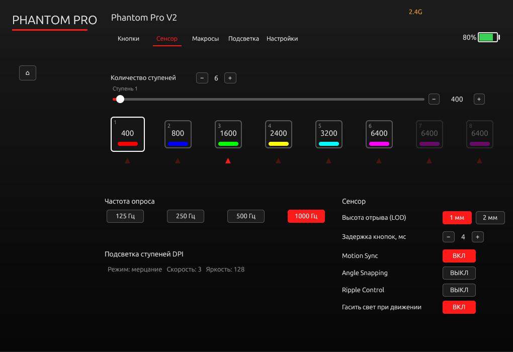
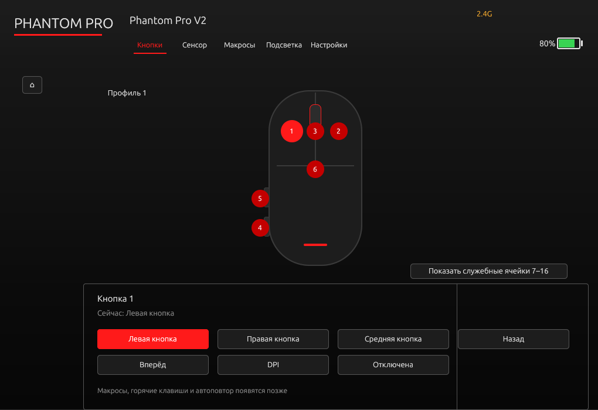
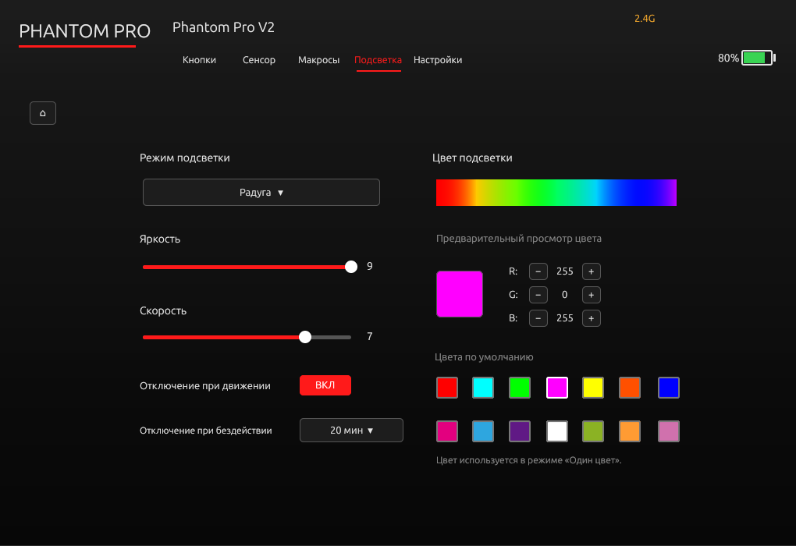

# phantom-pro-linux

**Unofficial** Linux tool for the **Ardor Gaming Phantom Pro V2** wireless mouse (ARDW-PH3395, PixArt PAW3395,
Compx controller, USB `3554:f52d` dongle / `3554:f52e` cable). It replaces the Windows-only configuration
program: DPI stages and colours, report rate, button assignment, macros, lighting, battery level.

> **Beta.** Tested on **one mouse** (ARDW-PH3395-BK). The tool writes to the mouse's own memory. It keeps a
> backup before writing and never sends the reset or firmware-update commands, but other models that share
> the dongle may behave differently. Read [Safety](#safety) first. Not affiliated with Ardor Gaming.

[Русская версия ниже](#по-русски).

| Sensor | Buttons | Lighting |
|---|---|---|
|  |  |  |

*Screenshots show the built-in style in demo mode (`MOUSE_CONFIG_DEMO=1`), not a real mouse.*

## What works

| Feature | CLI | GUI | Hardware-tested |
|---|---|---|---|
| Battery and charging state | `status` | yes | yes |
| DPI stages (8), count, current stage, stage colours | `set dpi/stages/current/color` | yes | yes |
| Report rate 125–1000 Hz, lift-off, debounce, motion sync, angle snapping, ripple | `set …` | yes | writes yes; the effect of rate, lift-off and debounce was not measured |
| Button assignment (left, right, middle, back, forward, DPI, off) | `set key` | yes | yes |
| Macros (keyboard keys, pauses, repeat) | `macro …` | yes, with a recorder | yes (keyboard keys) |
| Body light: mode, colour, speed, brightness, idle time | `set light-…` | yes | written and read back; the light itself was not observed |
| Over the 2.4G dongle and over the USB cable | both | both | yes |
| Settings survive switching the mouse off | | | yes |

Not done: profile switching, DPI above 12800, pairing, calibration, firmware update (deliberately), editing the
DPI-light brightness and speed. Macros can be replaced but not erased (the mouse refuses empty blocks).
The protocol is written down in [docs/PROTOCOL.md](docs/PROTOCOL.md).

## Install

Needs a recent Rust toolchain (1.90+). The CLI has no dependencies beyond `libc`.

```sh
sudo cp udev/70-mouse-config.rules /etc/udev/rules.d/
sudo udevadm control --reload && sudo udevadm trigger --subsystem-match=hidraw   # or replug the dongle

cargo build --release                      # CLI only: target/release/mouse-config
```

The GUI uses [GPUI](https://crates.io/crates/gpui) (X11 or Wayland, Vulkan). On Debian/Ubuntu:

```sh
sudo apt install libxkbcommon-x11-dev libx11-xcb-dev libwayland-dev libvulkan-dev
scripts/install.sh        # builds with --features gui, links ~/.local/bin, adds a desktop entry
```

The GUI follows the layout of the vendor's window, with its own built-in style. If you also have the vendor
artwork it can use it instead; that artwork belongs to Ardor and is **not** in this repository. Extract the vendor
installer (`innoextract -e <setup.exe>`), run `scripts/install-assets.sh <extracted>/app/res`, and the images are
copied to `~/.local/share/mouse-config/assets`. `MOUSE_CONFIG_SKIN=builtin` forces the built-in style even then.

`MOUSE_CONFIG_DEMO=1 mouse-config-gui` opens the window with typical settings and writes nothing, which is handy
for trying the interface or developing without the mouse.

## Use

```sh
mouse-config status                         # link, battery
mouse-config show                           # decoded settings
mouse-config set dpi 3 1600                 # stage 3 = 1600 DPI
mouse-config set rate 1000
mouse-config set light-color ff00ff
mouse-config macro set 6 hello "tap:h tap:i wait:50 click:left"
mouse-config backup                         # save the settings area; `restore FILE` writes it back
mouse-config --help
```

Run `mouse-config-gui` (or the **Phantom Pro V2** entry in your launcher).

## Safety

* Before every write session the current settings are saved to `~/.config/mouse-config/` (`auto-*.txt`,
  `macro-slot*-*.txt`). `mouse-config restore FILE` puts a settings backup back.
* The tool refuses to write if the settings area does not parse (bad checksums).
* Only read, write, battery and status commands are sent. Factory reset (`0x09`), firmware update mode
  (`0x0d`) and MTK mode (`0x11`) are excluded in code.
* A macro, once stored, cannot be erased by this tool or, as far as we know, by writing; replace or disable it.
* Key slots 7–16 have no physical button; slots 9–12 hold factory assignments of unknown purpose. Leave them.

## Development

```sh
cargo test                  # parsing, encoding and checksum tests (no hardware needed)
cargo clippy --all-targets
```

Layout: `src/device.rs` (hidraw transport), `src/config.rs` (settings image), `src/macros.rs`, `src/ops.rs`
(guarded writes, backups), `src/main.rs` (CLI), `src/gui.rs` (GPUI). `vendor/xattr` is a one-line patch of a
transitive dependency, see `vendor/README.md`.

Reports and pull requests are welcome, especially hardware reports from other models with the `3554:f52d`
dongle. Please include the output of `mouse-config status` and `mouse-config show`.

## License

Dual-licensed under **MIT** or **Apache-2.0**, at your option ([LICENSE-MIT](LICENSE-MIT),
[LICENSE-APACHE](LICENSE-APACHE)).

---

## По-русски

Неофициальная программа для Linux для мыши **Ardor Gaming Phantom Pro V2**: ступени DPI и их цвета, частота
опроса, назначение кнопок, макросы, подсветка, заряд батареи. Есть командная строка и окно на GPUI, повторяющее
раскладку фирменной программы. Работает и через донгл 2.4G, и по кабелю USB.

**Бета.** Проверено на одной мыши. Программа пишет в память мыши: перед записью сохраняется резервная копия, а
команды сброса и обновления прошивки в коде отсутствуют. Подробности и установка выше; протокол описан в
[docs/PROTOCOL.md](docs/PROTOCOL.md). Графика Ardor в репозиторий не входит.
